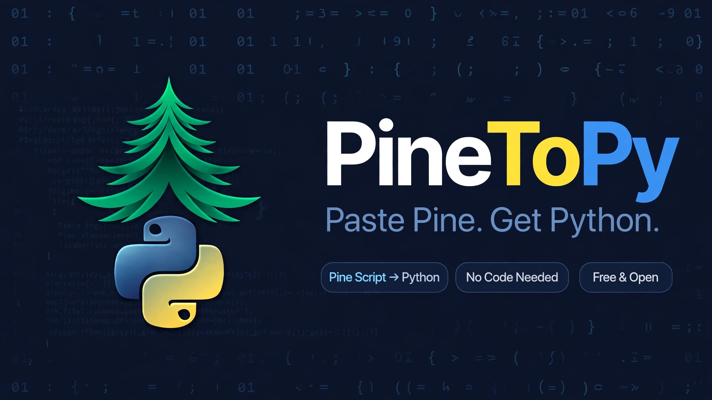

PineToPy



**Paste Pine. Get Python.**

PineToPy converts TradingView Pine Script into clean, runnable Python — no manual rewriting, no code needed.

---

What it does

- Paste your Pine Script
- Get Python back instantly
- Backtest it, edit it, run it anywhere

Built for traders who want to move from TradingView to Python without rewriting everything.

How it works

1. Paste your Pine Script
2. Click Convert
3. Copy your Python code

Example

**Pine Script:**
```pine
//@version=5
indicator("My Strategy")
fast = ta.sma(close, 9)
slow = ta.sma(close, 21)
plot(fast, color=color.blue)
plot(slow, color=color.red)
*Python:*
fast = close.rolling(9).mean()
slow = close.rolling(21).mean()
Features

- ✅ Pine Script → Python conversion
- ✅ Clean, readable Python output
- ✅ Works with indicators & strategies
- ✅ Copy in one click
- ✅ Free & open

Installation
git clone https://github.com/your-username/PineToPy
cd PineToPy
pip install -r requirements.txt
python app.py
Roadmap

- [ ] Support for more Pine functions
- [ ] Strategy backtesting in Python
- [ ] Export to .py file
- [ ] Web version

Contributing

Pull requests welcome. If you find a Pine function that doesn't convert right, open an issue.

License

MIT — free to use.

---

Made with PineToPy — Paste Pine. Get Python.
